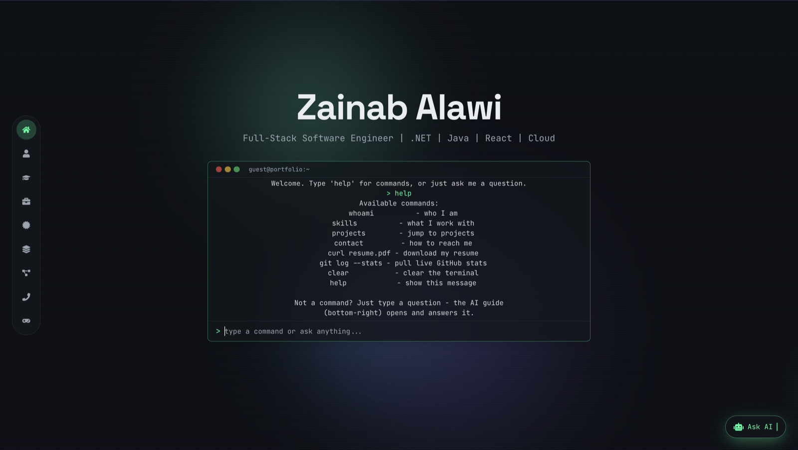
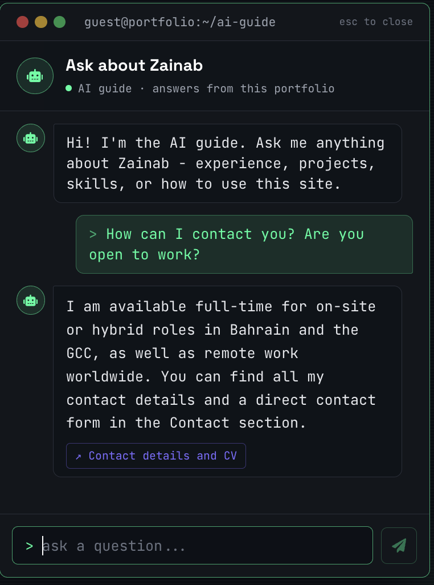
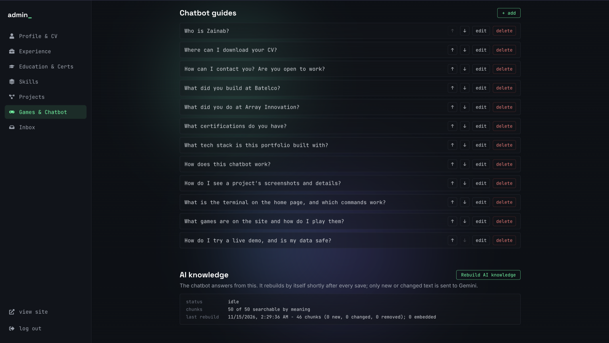
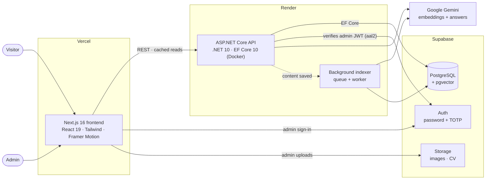

# Zainab Alawi — Portfolio

A full-stack personal portfolio with an AI guide that answers questions about my work, using only my own content.

**Live site:** https://zainab-alawi-portfolio.vercel.app

Every piece of content on the site (experience, education, certifications, skills, projects and the AI guide's answers) lives in a PostgreSQL database and is edited through a private, two-factor-protected admin dashboard. Changing content never needs a code change or a redeploy.



<table>
  <tr>
    <td width="36%"></td>
    <td></td>
  </tr>
  <tr>
    <td align="center"><sub>AI guide: a grounded answer with a source link</sub></td>
    <td align="center"><sub>Private admin: chatbot guides and AI knowledge status</sub></td>
  </tr>
</table>

---

## Highlights

- **AI guide (RAG).** Visitors ask questions in a chat panel or in the home-page terminal. The API embeds the question, finds the closest pieces of my content with pgvector, and has Gemini answer from those pieces only. The answer streams back word by word (Server-Sent Events) with links to where it came from on the site.
- **Content from the database.** Nothing about me is hard-coded in the frontend. A background indexer keeps the AI's knowledge in step: every admin save queues a re-embed of only the text that changed.
- **Private admin dashboard.** Password plus authenticator-app code (Supabase Auth, TOTP). The API itself checks the second factor, so a stolen password alone can't change anything.
- **Interactive extras.** A working terminal (`help`, `whoami`, `skills`, `projects`, `git log --stats`, …), live GitHub stats, and a Playground page with four small browser games.
- **Built to be safe in public.** Per-IP rate limits, a strict Content Security Policy, deny-all row-level security on every table, and 213 automated API tests in CI.

## Architecture



**How a question is answered:** question → embedding (Gemini `gemini-embedding-001`, 768 dimensions) → top 6 matching chunks by cosine distance in pgvector (keyword search as a fallback) → a guarded prompt to Gemini → answer streamed to the browser, with source links for the entries the model actually cited.

## Key decisions

| Decision | Why |
|---|---|
| **All content in the database**, no seed data in code | The site is a CMS for one person. Content changes are a form save, not a commit. |
| **No repository layer.** `DbContext` + a generic `OrderedCrudController<T>` | Every content type is the same shape: an ordered list with public reads and admin-only writes. One base controller covers create, read, update, delete and reorder without a layer of pass-through classes. |
| **Auth lives in the API**, not just the UI | The `AdminOnly` policy needs a Supabase-issued token for the owner's account *and* the `aal2` claim (password + authenticator code). Hiding the admin page is not the protection; the API is. |
| **Deny-all row-level security** on every table | The browser holds the public Supabase key by design. With RLS on and no policies, that key can't read or write any table; all data goes through the API. |
| **Background indexing** with a `Channel<T>` queue and a `BackgroundService` | Admin saves return instantly. Embeddings are paced for the Gemini free tier, and only changed text is re-embedded. |
| **Streamed answers** (Server-Sent Events) | The first words show up in about a second instead of after the whole answer is ready. |
| **Cached reads** (Next.js, 1 hour) + on-save revalidation | Visitors get a fast page even while the free-tier API is asleep; admin edits still show up immediately. |
| **Free tiers only** | Vercel, Render, Supabase and Gemini all run on their free plans. |

## Security

- Two-factor admin login, checked by the API (`aal2`), sign-ups disabled
- Per-IP rate limits: contact form 5 per 10 minutes; AI guide 10 per minute and 100 per day
- Contact form honeypot and length limits; AI questions capped at 500 characters
- Content Security Policy, HSTS, `frame-ancestors`, `Referrer-Policy` and `Permissions-Policy` headers
- CORS locked to the frontend origin; errors returned as ProblemDetails with no stack traces
- Secrets only in `dotnet user-secrets`, `.env.local` and the hosting dashboards, never in the repo

## Tech stack

**Frontend:** Next.js 16 (App Router), React 19, TypeScript, Tailwind CSS, Framer Motion, supabase-js, react-icons
**Backend:** ASP.NET Core (.NET 10), Entity Framework Core 10, Npgsql, Pgvector, JWT bearer auth, rate limiting, health checks
**Data and AI:** PostgreSQL on Supabase with pgvector, Supabase Auth and Storage, Google Gemini
**Tooling:** xUnit + `WebApplicationFactory` (213 tests), ESLint, Prettier, GitHub Actions, Dependabot, Docker
**Hosting:** Vercel (frontend), Render (API, Docker), Supabase (database, auth, storage)

## Repository layout

```
backend/    ASP.NET Core Web API (controllers, EF Core models and migrations, AI services)
frontend/   Next.js app (public site, /playground, private /admin)
tests/      API integration tests (auth on every admin endpoint, reordering, AI knowledge)
.github/    CI (build, tests, lint, format, Docker build), keep-alive ping, Dependabot
```

Setup steps are in [backend/README.md](backend/README.md) and [frontend/README.md](frontend/README.md).

## CI

Every push and pull request runs:

- **Backend:** build, the full test suite, and a Docker build of the production image
- **Frontend:** ESLint, a Prettier check, and a type-checked production build

`main` is protected and only moves forward to commits that passed CI.

## License

Copyright (c) 2026 Zainab Alawi. All rights reserved. The code is published so it can be read and reviewed; it may not be copied, reused or redistributed without my written permission. See [LICENSE](LICENSE).

To get in touch, use the contact form on the [live site](https://zainab-alawi-portfolio.vercel.app/#contact).
